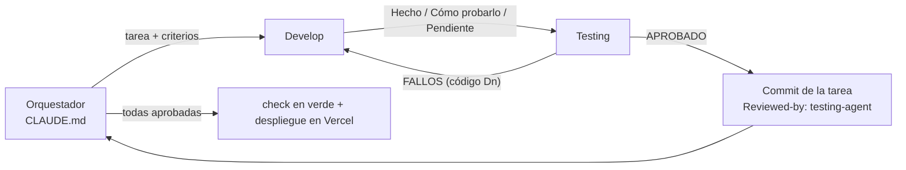

# Postula

**Postula** es un seguimiento de candidaturas para quien busca trabajo: guarda las ofertas a las que te apuntas, su estado y tus notas, y te enseña de un vistazo cómo va tu búsqueda.

- **App en producción:** https://postula-candidaturas.vercel.app
- **Usuario de prueba:** demo@postula.app (la contraseña se facilita en la entrega)

## Funcionalidades

- Registro, inicio y cierre de sesión con email y contraseña (Supabase Auth).
- Candidaturas con empresa, puesto, enlace a la oferta, ubicación, modalidad (remoto / híbrido / presencial), salario, estado, fecha y notas.
- Crear, editar y borrar (con confirmación); validación en el navegador y en el servidor.
- Lista ordenada por fecha con filtro por estado, búsqueda por empresa o puesto (sin importar acentos) y cambio rápido de estado.
- Panel con totales por estado, tasa de respuesta y candidaturas de los últimos 7 días.
- Interfaz en español, accesible con teclado y usable desde 320 px de ancho.
- Cada usuario ve solo sus datos (RLS en Postgres).

## Stack

| Capa | Tecnología |
|---|---|
| Framework | Next.js 16 (App Router, Server Components, Server Actions), TypeScript estricto |
| Datos y auth | Supabase: Auth (email + contraseña) y Postgres con Row Level Security |
| Estilos | Tailwind CSS 4 |
| Validación | zod (mismos esquemas en formulario y Server Action) |
| Tests | vitest (lógica pura) + `scripts/test-rls.mjs` (aislamiento contra Supabase real) |
| Despliegue | Vercel |

## Cómo se construyó: un equipo de 3 agentes

Postula se ha desarrollado con Claude Code organizado como un pequeño equipo de agentes, cada uno con su propio archivo de instrucciones:

| Agente | Archivo | Papel |
|---|---|---|
| **Orquestador** | [`CLAUDE.md`](CLAUDE.md) | Divide la [especificación](docs/SPEC.md) en [tareas](docs/TASKS.md), lanza a Develop y a Testing, decide cuándo algo está terminado, hace un commit por tarea aprobada y despliega. No escribe código de producto. |
| **Develop** | [`.claude/agents/develop.md`](.claude/agents/develop.md) | Programa cada tarea siguiendo su guía (servidor primero, zod, RLS, accesibilidad) y entrega con el formato "Hecho / Cómo probarlo / Pendiente". |
| **Testing** | [`.claude/agents/testing.md`](.claude/agents/testing.md) | Revisa la entrega contra las reglas, ejecuta `npm run check` y `npm run test:rls`, prueba la app en el navegador e intenta romperla. Responde **APROBADO** o **FALLOS** citando la regla incumplida. |

Las reglas comunes están en [`docs/DIRECTRICES.md`](docs/DIRECTRICES.md): cada una tiene un código (D1–D15) que Develop debe cumplir y Testing cita en cada fallo (calidad, seguridad, datos, interfaz y proceso).

### El bucle

Cada tarea pasa por Develop y Testing hasta que Testing la aprueba (máximo 5 vueltas). Si hay fallos, Develop recibe **solo esa lista** y responde punto por punto.



Cada vuelta queda anotada en [`docs/AGENT_LOG.md`](docs/AGENT_LOG.md). Ejemplo real: la tarea T3+T4 (CRUD y panel) necesitó **2 vueltas**. Testing descubrió que `/panel?aviso=__proto__` tumbaba el panel (la comprobación `value in MESSAGES` aceptaba claves heredadas de `Object.prototype`); Develop lo corrigió con `Object.hasOwn` y un test específico, y en la segunda vuelta Testing lo aprobó.

## Ejecutarlo en local

Requisitos: Node.js 22 y un proyecto de Supabase.

1. Instala dependencias:
   ```bash
   npm install
   ```
2. Copia las variables de entorno y rellénalas con las de tu proyecto de Supabase:
   ```bash
   cp .env.example .env.local
   ```
   | Variable | Uso |
   |---|---|
   | `NEXT_PUBLIC_SUPABASE_URL` | URL del proyecto (navegador y servidor) |
   | `NEXT_PUBLIC_SUPABASE_PUBLISHABLE_KEY` | Clave publicable (navegador y servidor) |
   | `SUPABASE_SECRET_KEY` | Solo para los scripts locales `test:rls` y `seed`; nunca en Vercel ni en el navegador |
3. Aplica las migraciones de `supabase/migrations/` en orden (con `supabase db push` o desde el editor SQL de Supabase).
4. Arranca el servidor de desarrollo:
   ```bash
   npm run dev
   ```

### Comandos

| Comando | Qué hace |
|---|---|
| `npm run dev` | Servidor local en http://localhost:3000 |
| `npm run check` | eslint + `tsc --noEmit` + vitest + `next build` (lo que Testing exige en verde) |
| `npm run test:rls` | Crea dos usuarios temporales y comprueba contra Supabase que uno no puede leer, editar ni borrar los datos del otro |
| `DEMO_PASSWORD=… npm run seed` | Crea o reutiliza `demo@postula.app` con esa contraseña (email confirmado) y sustituye sus candidaturas por 10 de ejemplo; se puede repetir sin duplicar datos |

## Seguridad

- **RLS en todas las tablas:** `applications` solo permite `select`, `insert`, `update` y `delete` cuando `auth.uid() = user_id`, y el rol anónimo no tiene acceso. Además, cada consulta del servidor filtra por el usuario de la sesión.
- **Server Actions** que validan la entrada con zod y comprueban la sesión antes de tocar datos; las páginas privadas redirigen a `/login` desde el servidor.
- **Claves solo en variables de entorno** (`.env.local`, panel de Vercel): `.env*` está en `.gitignore` y `.env.example` no lleva valores reales. La contraseña del usuario de prueba tampoco está en el repositorio.
- **Al navegador solo llegan** la URL de Supabase y la clave publicable. La clave secreta solo la usan los scripts locales.

## Estructura

```
.claude/agents/        develop.md y testing.md (subagentes)
CLAUDE.md              instrucciones del orquestador
docs/                  SPEC, TASKS, DIRECTRICES y AGENT_LOG
scripts/               test-rls.mjs y seed.mjs
supabase/migrations/   esquema de la base de datos + RLS
src/
  proxy.ts             refresco de la sesión de Supabase
  app/                 rutas (/, /login, /registro, /panel, /candidaturas/…) y Server Actions
  components/          componentes de interfaz
  lib/                 lógica pura con tests (validación, estadísticas, fechas…) y clientes de Supabase
```
