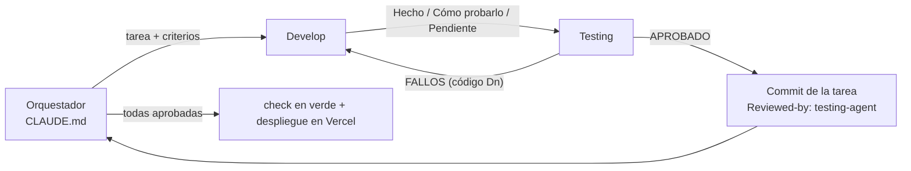

# Postula

[](https://github.com/SerkaFox/postula/actions/workflows/ci.yml)

**Postula** es un seguimiento de candidaturas para quien busca trabajo: guarda las ofertas a las que te apuntas, su estado y tus notas, y te enseña de un vistazo cómo va tu búsqueda.

- **App en producción:** https://postula-candidaturas.vercel.app
- **Usuario de prueba:** demo@postula.app (la contraseña se facilita en la entrega)

## Funcionalidades

- Registro, inicio y cierre de sesión con email y contraseña (Supabase Auth).
- Candidaturas con empresa, puesto, enlace a la oferta, ubicación, modalidad (remoto / híbrido / presencial), salario, estado, fecha y notas.
- Crear, editar y borrar (con confirmación); validación en el navegador y en el servidor.
- **✨ Rellenar con IA:** al crear una candidatura, pega el enlace o el texto de la oferta y Gemini propone empresa, puesto, ubicación, modalidad, salario, enlace y un resumen de requisitos en las notas. Los campos rellenados se marcan y nada se guarda hasta que lo revisas y pulsas «Crear candidatura».
- Lista ordenada por fecha con filtro por estado, búsqueda por empresa o puesto (sin importar acentos) y cambio rápido de estado.
- Panel con totales por estado, tasa de respuesta y candidaturas de los últimos 7 días.
- Interfaz en español, accesible con teclado y usable desde 320 px de ancho.
- Cada usuario ve solo sus datos (RLS en Postgres).

## Stack

| Capa | Tecnología |
|---|---|
| Framework | Next.js 16 (App Router, Server Components, Server Actions), TypeScript estricto |
| Datos y auth | Supabase: Auth (email + contraseña) y Postgres con Row Level Security |
| Estilos | Tailwind CSS 4 |
| Validación | zod (mismos esquemas en formulario y Server Action) |
| IA | Google Gemini por REST, sin SDK, con salida JSON estructurada: `gemini-3.5-flash-lite` y, de reserva si está saturado o sin cuota, `gemini-3.5-flash`, `gemini-flash-latest` y `gemini-3-flash-preview` |
| Tests | vitest (lógica pura), `scripts/test-rls.mjs` (aislamiento contra Supabase real) y Playwright (e2e en `e2e/`) |
| CI | GitHub Actions: lint + tipos + unit + build en cada push; RLS + e2e cuando hay secretos |
| Despliegue | Vercel |

## Cómo se construyó: un equipo de 3 agentes

Postula se ha desarrollado con Claude Code organizado como un pequeño equipo de agentes, cada uno con su propio archivo de instrucciones:

| Agente | Archivo | Papel |
|---|---|---|
| **Orquestador** | [`CLAUDE.md`](CLAUDE.md) | Divide la [especificación](docs/SPEC.md) en [tareas](docs/TASKS.md), lanza a Develop y a Testing, decide cuándo algo está terminado, hace un commit por tarea aprobada y despliega. No escribe código de producto. |
| **Develop** | [`.claude/agents/develop.md`](.claude/agents/develop.md) | Programa cada tarea siguiendo su guía (servidor primero, zod, RLS, accesibilidad) y entrega con el formato "Hecho / Cómo probarlo / Pendiente". |
| **Testing** | [`.claude/agents/testing.md`](.claude/agents/testing.md) | Revisa la entrega contra las reglas, ejecuta `npm run check` y `npm run test:rls`, prueba la app en el navegador e intenta romperla. Responde **APROBADO** o **FALLOS** citando la regla incumplida. |

Las reglas comunes están en [`docs/DIRECTRICES.md`](docs/DIRECTRICES.md): cada una tiene un código (D1–D17) que Develop debe cumplir y Testing cita en cada fallo (calidad, seguridad, datos, interfaz y proceso).

### El bucle

Cada tarea pasa por Develop y Testing hasta que Testing la aprueba (máximo 5 vueltas). Si hay fallos, Develop recibe **solo esa lista** y responde punto por punto.



Cada vuelta queda anotada en [`docs/AGENT_LOG.md`](docs/AGENT_LOG.md). Ejemplo real: la tarea T3+T4 (CRUD y panel) necesitó **2 vueltas**. Testing descubrió que `/panel?aviso=__proto__` tumbaba el panel (la comprobación `value in MESSAGES` aceptaba claves heredadas de `Object.prototype`); Develop lo corrigió con `Object.hasOwn` y un test específico, y en la segunda vuelta Testing lo aprobó.

## Ejecutarlo en local

Requisitos: Node.js 22 y un proyecto de Supabase.

1. Instala dependencias:
   ```bash
   npm install
   ```
2. Copia las variables de entorno y rellénalas con las de tu proyecto de Supabase:
   ```bash
   cp .env.example .env.local
   ```
   | Variable | Uso |
   |---|---|
   | `NEXT_PUBLIC_SUPABASE_URL` | URL del proyecto (navegador y servidor) |
   | `NEXT_PUBLIC_SUPABASE_PUBLISHABLE_KEY` | Clave publicable (navegador y servidor) |
   | `SUPABASE_SECRET_KEY` | Solo para `test:rls`, `test:e2e` y `seed` (local y secretos de CI); nunca en Vercel ni en el navegador |
   | `GEMINI_API_KEY` | Opcional, solo servidor: activa «Rellenar con IA». Sin ella el panel no aparece |
3. Aplica las migraciones de `supabase/migrations/` en orden (con `supabase db push` o desde el editor SQL de Supabase).
4. Arranca el servidor de desarrollo:
   ```bash
   npm run dev
   ```

### Comandos

| Comando | Qué hace |
|---|---|
| `npm run dev` | Servidor local en http://localhost:3000 |
| `npm run check` | eslint + `tsc --noEmit` + vitest + `next build` (lo que Testing exige en verde) |
| `npm run test:rls` | Crea dos usuarios temporales y comprueba contra Supabase que uno no puede leer, editar ni borrar los datos del otro (candidaturas y usos de IA) |
| `npm run test:e2e` | Tests e2e con Playwright (registro, login, CRUD, filtros, cambio de estado, 404 de una candidatura ajena, 320 px, movimiento reducido y, si hay `GEMINI_API_KEY`, autorrelleno con IA). Compila y arranca la app en el puerto 3200 (o usa `E2E_BASE_URL`); crea sus usuarios con la API de administración y los borra al terminar. La primera vez: `npx playwright install chromium` |
| `DEMO_PASSWORD=… npm run seed` | Crea o reutiliza `demo@postula.app` con esa contraseña (email confirmado) y sustituye sus candidaturas por 10 de ejemplo; se puede repetir sin duplicar datos |

## Diseño

- Ilustraciones propias generadas con **Codex CLI** en un mismo estilo (3D suave, paleta índigo/azul/ámbar/esmeralda) y optimizadas a WebP; prompts y uso de cada una en [`docs/ASSETS.md`](docs/ASSETS.md). Se usan solo en la portada, la sección de agentes, el estado vacío del panel y el login/registro.
- Imagen para redes (Open Graph y Twitter) generada con `next/og` sobre `og-bg.jpg`.
- Movimiento sutil solo con CSS: aparición escalonada, contadores en los KPI, barra por estado que crece y una flotación suave en la portada. Todo se desactiva con `prefers-reduced-motion` y nada mueve el layout (reglas D16–D17).

## Integración continua

[`.github/workflows/ci.yml`](.github/workflows/ci.yml) ejecuta en cada push y pull request `lint`, `typecheck`, los tests unitarios y `build` (con variables públicas de relleno, sin secretos). Si el repositorio tiene los secretos `NEXT_PUBLIC_SUPABASE_URL`, `NEXT_PUBLIC_SUPABASE_PUBLISHABLE_KEY` y `SUPABASE_SECRET_KEY`, un segundo job instala Chromium y ejecuta `test:rls` y `test:e2e`.

## IA

- **Qué se envía a Gemini:** solo el texto de la oferta. Si pegas un enlace, el servidor descarga la página y manda su título, su meta descripción, los datos `JobPosting` de schema.org si los hay y el texto visible, recortado a ~12.000 caracteres. No se envían tus candidaturas, tu email ni ningún otro dato de la cuenta.
- **El texto de la oferta se trata como no fiable:** va entre marcas y la instrucción del sistema dice a Gemini que ignore cualquier orden que contenga. La respuesta se pide como JSON con esquema, se valida con zod y solo se usa para rellenar campos del formulario, que el usuario revisa antes de guardar.
- **Descarga de enlaces segura (SSRF):** solo `http`/`https` en puertos por defecto; el host se resuelve y se rechazan IPs privadas, loopback, link-local y de metadatos (también tras cada redirección, máximo 3, y en la propia conexión, sin ventana para DNS rebinding); 8 s de límite, 1,5 MB como máximo y solo `text/html`. Si la web pide iniciar sesión (LinkedIn) o bloquea bots, se pide pegar el texto.
- **Límites:** solo usuarios con sesión, 20 autorrellenos por usuario cada 24 h y 20.000 caracteres por petición. El uso se apunta en `ai_usage` con la función `consume_ai_quota()` (`security definer`), que bloquea por usuario, cuenta y apunta en una sola transacción: llamadas en paralelo no superan el límite. Con RLS, cada usuario solo lee sus filas y no puede insertarlas, borrarlas ni editarlas directamente.
- **La clave `GEMINI_API_KEY` solo existe en el servidor** (`.env.local` y variable sensible en Vercel); la llamada a Gemini se hace desde una Server Action y la clave nunca llega al navegador.

## Seguridad

- **RLS en todas las tablas:** `applications` solo permite `select`, `insert`, `update` y `delete` cuando `auth.uid() = user_id`; `ai_usage`, solo `select` de las filas propias (se escribe únicamente con `consume_ai_quota()`). El rol anónimo no tiene acceso. Además, cada consulta del servidor filtra por el usuario de la sesión.
- **Server Actions** que validan la entrada con zod y comprueban la sesión antes de tocar datos; las páginas privadas redirigen a `/login` desde el servidor.
- **Claves solo en variables de entorno** (`.env.local`, panel de Vercel): `.env*` está en `.gitignore` y `.env.example` no lleva valores reales. La contraseña del usuario de prueba tampoco está en el repositorio.
- **Al navegador solo llegan** la URL de Supabase y la clave publicable. La clave secreta solo la usan los scripts y los tests (en local o como secreto de CI).

## Estructura

```
.claude/agents/        develop.md y testing.md (subagentes)
.github/workflows/     ci.yml (GitHub Actions)
CLAUDE.md              instrucciones del orquestador
docs/                  SPEC, TASKS, DIRECTRICES, ASSETS y AGENT_LOG
e2e/                   tests e2e con Playwright
public/illustrations/  ilustraciones (WebP) y fondo de la imagen social
scripts/               test-rls.mjs y seed.mjs
supabase/migrations/   esquema de la base de datos + RLS
src/
  proxy.ts             refresco de la sesión de Supabase
  app/                 rutas (/, /login, /registro, /panel, /candidaturas/…) y Server Actions
  components/          componentes de interfaz
  lib/                 lógica pura con tests (validación, estadísticas, fechas…) y clientes de Supabase
```
